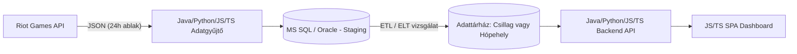

# League of Legends mérkőzés-adattárház

## 1. Szereplők és jogosultságok

| Szerep | Igény | Felelősség / hozzáférés |
| --- | --- | --- |
| Adatgyűjtő kliens (Rendszer) | Folyamatos, automatizált hozzáférés a Riot API-hoz és az adatbázishoz | API kéréseket indít, nyers adatokat ír a Staging rétegbe. |
| Elemző / Játékos | A legfrissebb e-sport statisztikák böngészése | Szűr, keres és megtekinti a vizualizált grafikonokat a weboldalon (csak olvasási jog). |
| Adatbázis-adminisztrátor | Az adattárház karbantartása és az ETL/ELT folyamatok menedzselése | Futtatja az SQL scripteket, monitorozza a teljesítményt, kezeli a sémákat (teljes hozzáférés). |

## 2. Use case-ek / user storyk

### Mérkőzésadatok kötegelt letöltése 24 órás hozzáférési ablakkal

**Szereplő:** Adatgyűjtő kliens / Adatbázis-adminisztrátor
- **Előfeltétel:** A rendszer rendelkezik egy frissen generált, 24 óráig érvényes Riot API fejlesztői kulccsal.
- **Fő folyamat:**
  1. A kliens aszinkron módon elkezdi lekérni egy megadott játékosbázis mérkőzéseinek azonosítóit (Match ID).
  2. A kliens aszinkron módon, párhuzamosítva letölti a mérkőzések részletes JSON adatait.
  3. A rendszer folyamatosan figyeli és betartja a HTTP fejlécekben kapott Rate Limit korlátokat a kitiltás elkerülése érdekében.
  4. A letöltött nyers adatok folyamatosan bekerülnek a Staging táblákba a 24 órás ablak végéig.
  5. Az időkorlát lejárta után az ETL/ELT folyamat azonosítja és kiszűri a már létező (duplikált) meccseket.
  6. A rendszer frissíti a dimenziótáblákat (SCD logikával) és betölti a tényrekordokat a dimenzionális sémába.
- **Alternatív / hibafolyamatok:** Ha a Riot API `429 Too Many Requests` hibát ad, a worker leállítja a kéréseket a megadott Retry-After időtartamra, majd azonnal folytatja az adatgyűjtés maximalizálása érdekében.
- **Utófeltétel:** A 24 óra alatt begyűjtött több tízezer/százezer mérkőzés tisztítva bekerül az adattárházba, készen a vizualizációra.

## 3. Funkcionális követelmények

| Követelmény | Elfogadási kritérium | Prioritás |
| --- | --- | --- |
| A rendszer aszinkron módon le tudja tölteni a meccseket a Riot API-ból. | Adott egy játékoslista, a kliens automatizáltan lekéri a meccstörténetüket JSON formátumban. | Kötelező |
| A rendszer automatikusan kezeli az API limiteket (Rate Limiting). | Ha a limit közeledik, a program lassít; 429-es hiba esetén kivárja a kötelező időt leállás nélkül. | Kötelező |
| Nyers adatok betöltése a Staging rétegbe. | A letöltött meccsek nyomon követhető módon, nyers formában tárolódnak az adatbázisban. | Kötelező |
| Duplikációk kiszűrése (Idempotencia). | Adott egy már betöltött Match ID, ha a rendszer újra találkozik vele, nem jön létre duplikált sor a ténytáblában. | Kötelező |
| Lassan változó dimenziók (SCD) kezelése az adatbázisban. | Ha egy játékos nevet vált, a régi adatsor lezárásra kerül (Valid To beállítva), és egy új sor jön létre a dimenziótáblában. | Kötelező |
| Megfelelő SQL adatmodell kialakítása elemzésre. | Az adatok egy optimalizált, tény- és dimenziótáblákból álló sémába transzformálódnak. | Kötelező |
| A kinyert statisztikák webes megjelenítése. | Adott egy webalapú dashboard, ami a ténytábla alapján diagramokat rajzol ki (pl. hősök győzelmi aránya, átlag sebzés). | Kötelező |
| Lekérdezések időbeli szűrése patch alapján. | A felhasználó a weboldalon kiválaszthat egy adott játékfrissítést (patch-et), és a statisztikák arra szűkülnek. | Ajánlott |
| A weboldal reszponzív (mobilbarát) megjelenése. | A dashboard diagramjai és szűrői olvashatóak és használhatóak maradnak mobiltelefon böngészőjében is. | Ajánlott |
| Dark mode (sötét mód) kapcsoló a felületen. | A felhasználó egy gombnyomással válthat világos és sötét téma között, ami igazodik a "gamer" esztétikához. | Lehetséges |
| Játékoskereső funkció a weboldalon. | A felhasználó beírhat egy konkrét játékosnevet, és a rendszer csak az ő személyes statisztikáit jeleníti meg a gyűjtött adatokból. | Lehetséges |

Prioritás: **Kötelező** = a végtermékhez szükséges; **Ajánlott** = fontos; **Lehetséges** = idő esetén opcionális.

## 4. Üzleti szabályok és korlátok

| Szabály vagy korlát | Indoklás |
| --- | --- |
| Az elemzés alapja egy egyszeri, 24 órás API ablakban gyűjtött adathalmaz. | A témavezetővel egyeztetve ez biztosítja a projekt megvalósíthatóságát a Riot szigorú API hozzáférési szabályzata mellett. |
| Csak kompetitív (Ranked Solo/Duo) meccsek kerülnek letöltésre. | A "casual" játékmódok (pl. ARAM) torzítanák a statisztikákat, a projekt a valós metát vizsgálja. |
| Hitelesítő adatok és API kulcsok nem tárolhatók a forráskódban. | Biztonsági alapkövetelmény és a Riot Games fejlesztői szabályzatának megsértése tiltással jár. |
| Egy mérkőzés (Match ID) csak egyszer szerepelhet a ténytáblában. | A duplikált adatok teljesen használhatatlanná teszik az aggregált statisztikákat (pl. Win Rate). |
| A webes felület csak "olvas" (Read-Only) az adatbázisból. | Biztonsági okokból a vizualizációs frontend nem indíthat adatbázis-módosító utasításokat. |

## 5. Felhasználói felület és munkafolyamat

A projekt felhasználói felülete egy egyoldalas, analitikai dashboard lesz. Célja, hogy a nyers SQL adatokból vizuálisan fogyasztható statisztikákat generáljon. A felület felső részén szűrők (pl. Patch verzió, Tier) helyezkednek el, amelyek alatt a betöltött adatok dinamikusan frissülő oszlop- és vonaldiagramokon, illetve toplistákon jelennek meg. Nincs szükség regisztrációra vagy bejelentkezésre, az oldal megnyitása után az aggregált statisztikák azonnal láthatóak.

## 6. Nem funkcionális követelmények

| Követelmény | Ellenőrzés módja |
| --- | --- |
| Az összetett analitikai SQL lekérdezések normál terhelés mellett másodpercek alatt lefutnak a betöltött adathalmazon. | SQL Server Execution Plan elemzése, valamint a futási és I/O idő manuális mérése indexelés előtt/után. |
| Hálózati hiba vagy API leállás esetén az adatbázis nem kerül inkonzisztens (félkész) állapotba. | Integrációs teszt futtatása tranzakciókezeléssel, szimulált hálózati megszakítással (Rollback ellenőrzés). |
| A webes dashboard diagramjai normál körülmények között gyorsan betöltődnek. | Böngészős hálózati (Network) teljesítménymérés a végpontok válaszidejének (Latency) vizsgálatával. |

## 7. Nyitott kérdések és kockázatok

| Kérdés / kockázat | Hatás | Felelős | Feloldás / döntés |
| --- | --- | --- | --- |
| Melyik dimenzionális sémát érdemes választani (Csillag vs. Hópehely)? | Befolyásolja a joinok számát, a lekérdezési sebességet és a redundanciát. | Hallgató | A tervezési fázisban mindkettő elméleti felmérése és a kutatási eredmény alapján történő véglegesítés. |
| Hol történjen az adatok transzformációja (ETL vagy ELT megközelítés)? | Befolyásolja a fejlesztési időt, a skálázhatóságot és az SQL Server I/O terhelését. | Hallgató | Egy kisebb adatcsomagon mindkét megoldás kipróbálása prototípusként. |
| Hogyan maximalizálható a letöltött meccsek száma a 24 óra alatt? | Meghatározza a végső adattárház méretét és a statisztikák pontosságát. | Hallgató | Az aszinkron kliens teljesítményhangolása a Rate Limitek határáig. |

## 8. Kezdeti technikai javaslat

### Javasolt megoldás

A javasolt architektúra egy Java (Spring Boot), Python vagy TypeScript (Node.js) alapú aszinkron adatgyűjtő szolgáltatásból, egy Dockerben futtatott relációs adatbázisból (Microsoft SQL Server vagy Oracle), valamint egy JavaScript vagy TypeScript alapú egyoldalas (SPA) webes frontendből áll. Az adatgyűjtő a 24 órás hozzáférési ablak alatt a lehető legtöbb nyers JSON-t tölti le az adatbázis Staging rétegébe. Az ablak lezárulta után a rendszer elvégzi a tisztítást, a duplikációk szűrését és a dimenziós modellbe való betöltést (amelynek pontos helye – ETL vagy ELT – nyitott kutatási kérdés marad). A webes kliens API-n keresztül kinyeri és interaktívan vizualizálja az aggregált statisztikákat.

### Technológiai irány

| Terület | Jelölt technológia / megközelítés | Megfontolás oka | Nyitott kérdés / kockázat |
| --- | --- | --- | --- |
| Adatgyűjtő és Backend API | Java (Spring Boot), Python vagy TypeScript (Node.js) | Erős aszinkron hálózati támogatás és megbízhatóság a hibamentes API hívásokhoz. | A rate-limitek (429) és a timeoutok precíz, folyamatos kezelése 24 órán keresztül. |
| Adatbázis / Tárolás | Microsoft SQL Server vagy Oracle Database | Komoly analitikai (OLAP) támogatás, ablakfüggvények és vizuális Execution Plan a dolgozathoz. | Lokális I/O, particionálás és memória optimalizálása nagy adathalmaznál. |
| Adatbetöltés (Transzformáció) | ETL (Backend kódban) vagy ELT (Adatbázisban) | A projekt egyik fő kutatási fókusza a két megközelítés sebességének és I/O terhelésének mérése. | A JSON parsing és az adategyesítés teljesítménykülönbsége a két platformon. |
| Webes UI / Frontend | JavaScript vagy TypeScript alapú SPA (pl. React, Vue vagy Angular) | Gyors, reszponzív, oldalfrissítés nélküli dashboard készítése statisztikai komponensekkel. | A dinamikus adatok zökkenőmentes rákötése a választott diagram-könyvtárra. |
| Telepítés | Docker konténerizáció | Egyetlen hordozható és reprodukálható környezetben indítható a backend, a frontend és az adatbázis is. | Konténerek erőforrás-allokációja (memória/CPU limit) a lokális gépen. |

### Kezdeti architektúravázlat

### Megvalósíthatóság és technikai kockázatok

| Kockázat / feltételezés | A 2. félévre tervezett validáció | Tartalék megközelítés |
| --- | --- | --- |
| A 24 órás hozzáférés alatt nem gyűlik össze elég adat egy robusztus adattárház bemutatásához. | Egy 1-2 órás tesztfutás elvégzése a kliens sebességének és a napi projektált adatmennyiségnek a mérésére. | A statisztikai vizsgálat leszűkítése egyetlen, de nagyon aktív ligára (pl. EUW Challenger). |
| Az ETL és ELT folyamatok közül az egyik túlzottan leterheli a lokális gépet. | Egy kisebb (néhány tízezres) adathalmazon mindkét megoldás kipróbálása prototípusként, időméréssel. | Az eredmény alapján a gyorsabb/stabilabb módszer kizárólagos alkalmazása a teljes betöltésnél. |
| A weblap lassan töltődik be a több milliós COUNT/SUM SQL lekérdezések miatt. | Execution Plan elemzés és indexelési stratégiák folyamatos tesztelése a fejlesztés során. | Előre kalkulált aggregált (Summary) táblák létrehozása, amelyekből a backend azonnal olvas. |